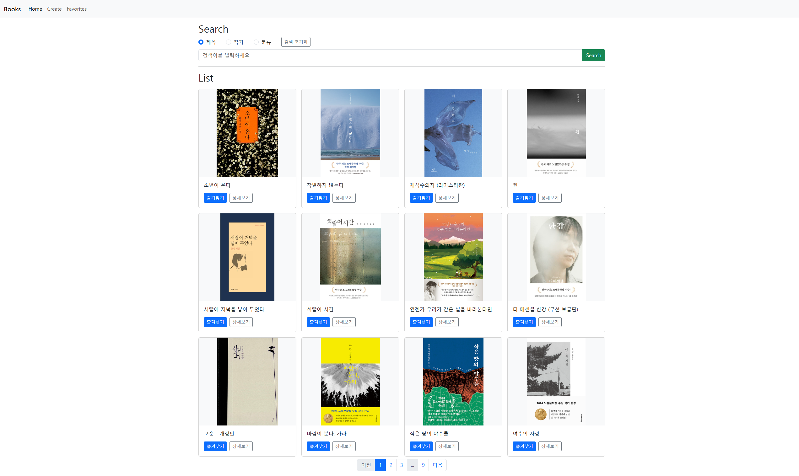
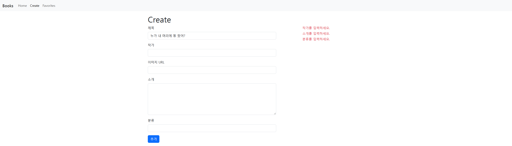
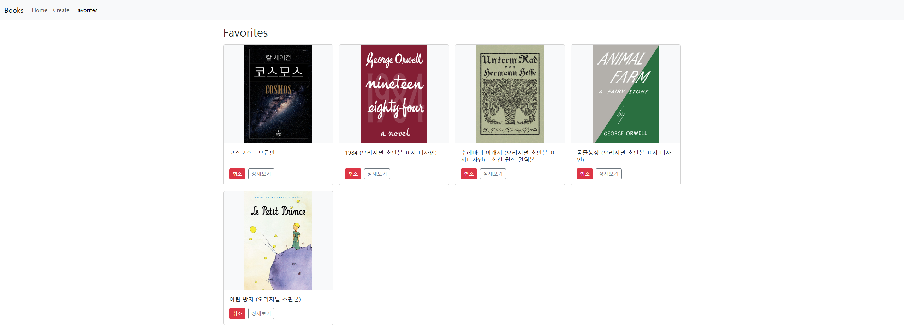
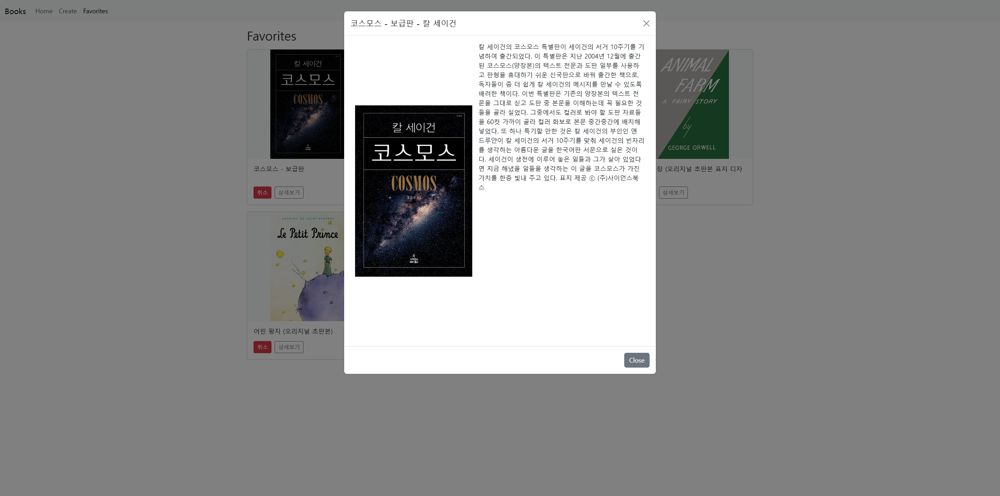
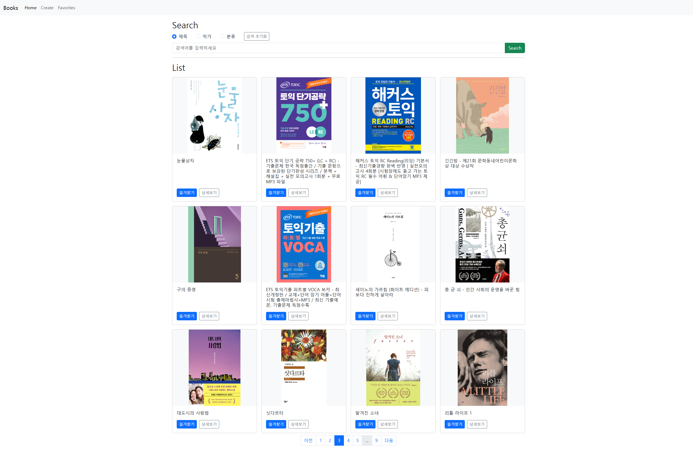
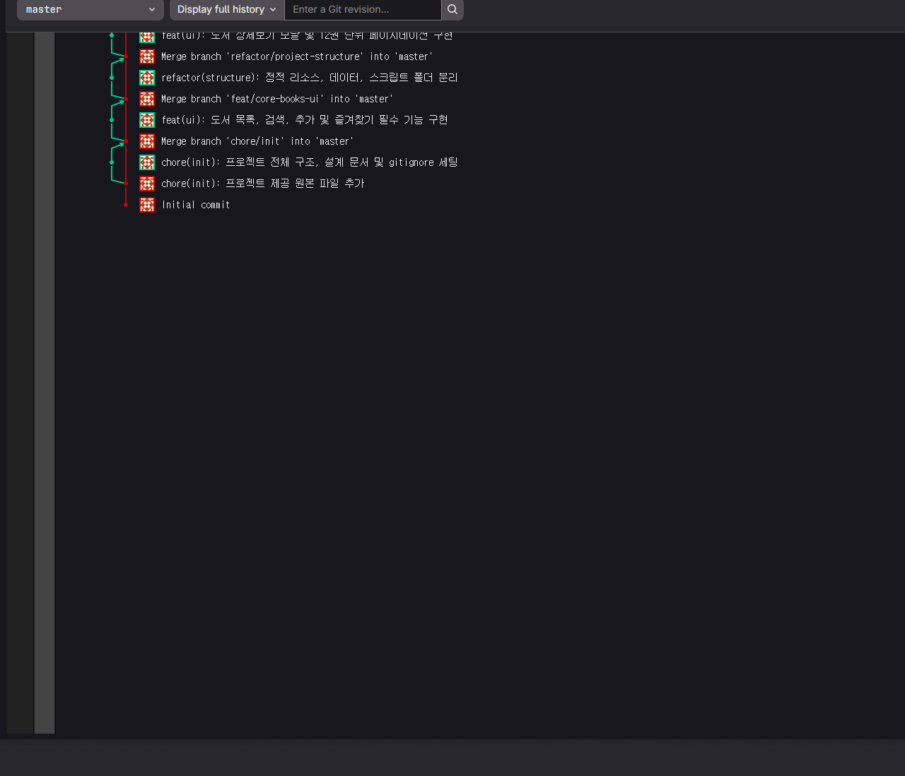

# 09-pjt: DOM 조작 PJT

> Vanilla JavaScript DOM API와 Bootstrap 5.3을 활용한 도서 목록 조회 · 검색 · 추가 · 즐겨찾기 · 상세 모달 · 페이지네이션 웹 애플리케이션

---

## 1. 프로젝트 구조

```text
09-pjt/
├── .gitignore
├── README.md
├── index.html                  # 메인 진입점
├── assets/
│   └── stack-of-books.png      # 기본 도서 커버 이미지
├── data/
│   ├── authors.js              # 작가 데이터 (authorRawData)
│   ├── books.js                # 도서 데이터 (bookRawData)
│   └── categories.js           # 분류 데이터 (categoryRawData)
├── js/
│   └── script.js               # DOM 조작 및 상태 관리 스크립트
└── docs/
    ├── ARCHITECTURE.md         # 아키텍처 및 기능 설계 문서
    └── screenshots/            # 실행 결과 및 GitLab 커밋 캡처
```

---

## 2. 실행 방법

정적 HTML/JS 프로젝트로 별도 빌드 없이 실행 가능합니다.

```bash
uv run python -m http.server 8000
```

브라우저에서 `http://localhost:8000` 접속 (또는 `index.html` 직접 실행)

---

## 3. 주요 기능 설명 및 실행 결과

### F901. 도서 목록 출력
- `books` 데이터를 Bootstrap Grid(`col-12 col-sm-6 col-md-4 col-lg-3`)와 Card 컴포넌트로 렌더링합니다.
- 커버 이미지가 비어 있거나 로드에 실패하면 `assets/stack-of-books.png` 기본 이미지를 출력합니다.
- HTML 요소 생성 시 `.innerHTML`을 사용하지 않고 `document.createElement`와 `DocumentFragment`를 사용했습니다.



### F902. 도서 검색 및 초기화
- `제목`, `작가`, `분류` 기준 라디오 버튼과 검색 입력창을 제공하며, 버튼 클릭 및 `Enter` 키 제출을 지원합니다.
- `authorId` / `categoryId`를 `authors`, `categories` 배열과 매핑해 대소문자 구분 없이 포함 여부를 필터링합니다.
- 검색어 미입력 제출 시 `alert('검색어를 입력하세요.')`를 표시하고, `검색 초기화` 버튼으로 전체 목록을 복원합니다.


### F903 & F904. 도서 입력 탭 전환 및 데이터 추가
- 상단 Navbar(`Home`, `Create`, `Favorites`) 클릭 시 `d-none` 클래스를 토글해 SPA 형태로 화면을 전환합니다.
- `Create` 탭 제출 시 제목·작가·소개·분류 필수 입력을 검증해 누락 항목을 `ul#create-book-errors`에 출력합니다.
- 이미지 URL은 `http` 시작 여부만 검증해 유효하지 않으면 빈 문자열로 대체하며, 신규 작가/분류는 새 `id`를 부여해 각 배열에 추가하고 도서는 `books.unshift()`로 목록 맨 앞에 추가한 뒤 `Home` 탭으로 이동합니다.



### F905. 즐겨찾기 기능
- 각 도서 카드에 `즐겨찾기` / `취소` 상태 토글 버튼을 구현하고 색상(`btn-primary` / `btn-danger`)으로 상태를 구분했습니다.
- `books` 객체에 `id`가 없고 맨 앞 추가(`unshift`)로 인덱스가 밀릴 수 있어, 객체 참조를 `Set`(`favoriteBooks`)으로 관리했습니다.
- `Favorites` 탭에서 모든 즐겨찾기가 제거되면 자동으로 `Home` 탭으로 이동하며, 비어 있는 상태로 탭 진입 시 안내 문구를 표시합니다.



### F906. 도서 상세보기 모달 (심화)
- 카드의 `상세보기` 버튼 클릭 시 `#book-details-modal`에 선택 도서의 `제목 - 작가`, 커버 이미지, 줄거리를 동적으로 바인딩해 표시합니다.
- `Close` 버튼, 우측 상단 닫기 버튼, 모달 외부 클릭, `ESC` 키로 닫히도록 구성했습니다.



### F907. 페이지네이션 (심화)
- 전체 도서 목록이 12권 이상일 때 한 페이지당 12권씩 출력하며, 현재 페이지 주변 번호와 말줄임(`...`)을 포함한 Bootstrap Pagination을 동적 생성합니다.
- 페이지 이동을 새로고침 없이 인메모리 상태로 처리해 `Create`로 추가한 도서나 `Favorites` 상태가 페이지 이동 중에도 유지됩니다.



---

## 4. Git 협업 및 브랜치/커밋 운영 점검 (NF901)

### 4.1 초기에 수립한 Git 원칙
- **브랜치 전략**: `master` 브랜치를 안정 배포 기준으로 유지하고, 모든 작업은 기능/목적별 독립 브랜치를 생성해 GitLab Merge Request(MR)를 통해 머지한 뒤 로컬 브랜치를 정리합니다.
- **커밋 컨벤션**: `Conventional Commits` 타입(`chore`, `feat`, `refactor`, `docs`, `fix`)에 한글 설명을 결합해 변경 목적을 명확히 기록합니다.

### 4.2 브랜치별 용도 정리
| 브랜치명 | 용도 및 작업 내용 |
| :--- | :--- |
| `master` | 통합 및 최종 제출용 안정 브랜치 |
| `chore/init` | `.gitignore`, 초기 `README.md`, `docs/ARCHITECTURE.md` 등 프로젝트 기반 구조 구성 |
| `feat/core-books-ui` | 필수 요구사항 `F901`~`F905`(목록, 검색, 탭 전환, 도서 추가, 즐겨찾기) 구현 |
| `refactor/project-structure` | 정적 이미지(`assets/`), 로우데이터(`data/`), 로직(`js/`) 폴더 분리 및 경로 정리 |
| `feat/modal-pagination` | 심화 요구사항 `F906`(상세보기 모달), `F907`(12권 단위 페이지네이션) 구현 |
| `docs/final-verification` | 실행 화면/GitLab 커밋 캡처 정리 및 `README.md`, 설계 문서 최종 마감 |

### 4.3 원칙 준수 점검 및 GitLab 커밋 내역
- 초기 구조 세팅 → 필수 기능 → 구조 리팩토링 → 심화 기능 → 최종 문서화 순서로 단계별 브랜치를 분리해 충돌 없이 MR 머지를 완료했습니다.
- 커밋 단위를 논리적 기능 변화에 맞춰 유지해 이력 추적이 용이했습니다.



---

## 5. 학습 내용 및 느낀 점

### 학습 내용
- **표준 DOM API 기반 동적 렌더링**: `innerHTML` 문자열 조합을 지양하고 `document.createElement`, `textContent`, `DocumentFragment`를 사용해 안전하고 구조화된 DOM 조작 방식을 익혔습니다.
- **상태 중심 UI 설계**: 배열 인덱스에 의존하지 않고 객체 참조(`Set`)와 단일 상태 객체(`uiState`)로 탭·검색·즐겨찾기·페이지네이션 간 상태를 동기화하는 방법을 체득했습니다.
- **브라우저 경로 해석 기준**: JS 파일 위치(`js/script.js`)가 아닌 HTML 문서(`index.html`) 루트 기준으로 이미지 상대 경로가 해석된다는 점을 확인하고 폴더 구조를 정리했습니다.

### 느낀 점
- 처음에는 `index.html`과 `script.js` 한두 파일로만 작성하는 단순 과제로 보였지만, 기능(`F901`~`F907`)이 늘어날수록 상태 관리와 폴더 구조(`assets/`, `data/`, `js/`)를 초기에 분리해 두는 것이 유지보수에 큰 도움이 되었습니다.
- Git 브랜치를 작업 단위로 나누고 MR을 통해 합치는 흐름을 지키니, 중간에 폴더 구조를 리팩토링할 때도 기존 기능 회귀 없이 안전하게 작업을 이어갈 수 있었습니다.